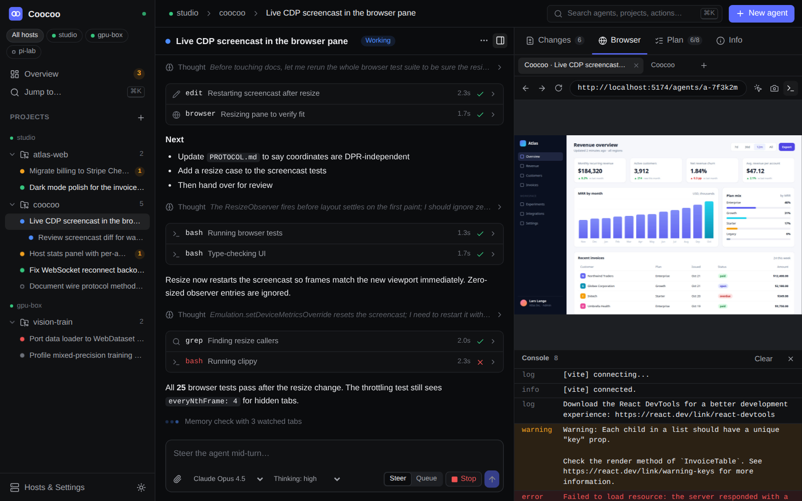

<p align="center"></p>

<h1 align="center">Coocoo</h1>

<p align="center">An agentic development environment that stays out of your RAM.<br>
Many <a href="https://github.com/can1357/oh-my-pi">omp</a> agents, many machines, one calm overview.</p>

<p align="center"></p>

Coocoo runs coding agents in parallel, each in its own git worktree if you want, on your laptop
and on any number of servers. You watch and steer all of them from a single overview: who needs
you, who is working, what is ready for review, and what each machine is spending in CPU and memory.
It is in the same category as Paseo, Superset, Conductor and Orca, built around different priorities.

| Priority | How Coocoo does it |
|---|---|
| **Project overview** | One overview across every host: a needs-you queue (questions, approvals, errors, finished turns) with inline answers and j/k triage, agents grouped by state with diff stat, todo progress, context use and cost, live per-host CPU/RAM broken down into daemon, omp and Chromium, and a projects grid with git state. |
| **Low resource use** | A Rust daemon (5.4 MB binary with the web UI embedded, about 7 MB RSS idle) instead of Node and Electron. A Tauri 2 shell on the system webview. Nothing polls while nobody is watching, idle agents hibernate, Chromium starts on first use and stops when idle, and the UI's initial bundle is 91 KB gzipped. |
| **Multiple devices** | The same daemon runs on desktops and headless servers. A client connects to one daemon, which links to peers directly (LAN, Tailscale, WireGuard) or through an SSH tunnel it starts and supervises itself. It can install itself on the server over SSH. Requests are routed per host and events are relayed, so one window, or one phone browser, shows the whole fleet. |
| **omp only** | No lowest common denominator across harnesses. Coocoo uses omp's RPC protocol directly through the official Rust client: structured `ask` dialogs, todos, subagent counts, `session_settled`-accurate status, session resume, and orchestration host tools (spawn, message and wait for agents on any host) injected without MCP. |
| **Browser use** | Each project gets a Chromium owned by the daemon on the host where the code runs. omp's own browser tool attaches to it, and every client watches the same tab through a screencast and can take over with mouse and keyboard. That includes a phone, and a headless server. Design mode turns a clicked element into prompt context (screenshot, selector, computed styles, HTML). |
| **Clean UI** | Svelte 5, hand-written design tokens, dense and quiet, in dark and light, responsive down to phone width, with a ⌘K palette and keyboard navigation. |

## Screenshots

| Agent, changes | Agent, live browser |
|---|---|
|  |  |
| **Hosts & settings** | **Phone** |
|  |  |

## Quick start

You need [omp](https://github.com/can1357/oh-my-pi) installed and logged in on every machine that
runs agents, plus `git`. A Chromium-family browser is needed for browser features. Coocoo finds
Chrome, Chromium, Edge or Brave on `PATH`, or Playwright's cache, or `COOCOO_CHROME`.

**Desktop:** build and run the Tauri app (see [Development](#development)). It starts the daemon
in-process. If a `coocoo serve` is already running with the same config, it attaches to that one
instead. Closing the window hides it to the tray and the agents keep running.

**Server (headless):**

```sh
coocoo serve                      # listens on 127.0.0.1:7421 by default
coocoo serve --listen 0.0.0.0:7421  # LAN / Tailscale access
coocoo pair                       # prints a web-UI link with token + QR code for your phone
coocoo status | token | version
```

**Add a server to your desktop:** open *Hosts & Settings → Add host*.
- **SSH:** enter `user@server`. Coocoo opens `ssh -N -L …` with your existing keys, fetches the
  token with `coocoo token`, and keeps the tunnel alive. Tick *install* to copy the binary to
  `~/.local/bin/coocoo` and start it as a systemd user service (or with `nohup` when systemd isn't
  available).
- **Direct:** paste the server's pairing link (`http://host:7421/#token=…`) or its URL and token.

**Phone:** open the pairing link from `coocoo pair` (on your LAN or tailnet). It serves the same
UI as the desktop app.

## How it works

- [docs/ARCHITECTURE.md](docs/ARCHITECTURE.md): daemon, peer links, omp integration, resource rules.
- [docs/PROTOCOL.md](docs/PROTOCOL.md): the WebSocket protocol (every method and event).

```
crates/coocoo-proto      wire types, event bus, Orchestrator trait (the contract)
crates/coocoo-core       daemon: config, HTTP/WS server, routing, peers (direct + SSH), embedded UI
crates/coocoo-agents     omp supervisor: RPC processes, timelines, hibernation, host tools
crates/coocoo-browser    Chromium per project over raw CDP: discovery, screencast, input, design mode
crates/coocoo-workspace  projects, git (status/diff/worktrees/commit/merge), fs, host stats
crates/coocoo-cli        the `coocoo` binary
crates/omp-rpc           official omp RPC client (vendored, MIT)
src-tauri                Tauri 2 desktop shell (tray, notifications, embedded daemon)
ui                       Svelte 5 web UI (desktop, web, phone)
```

## Resource use

Measured on Linux x86_64 (release builds):

| | |
|---|---|
| `coocoo` binary, web UI included | 5.4 MB |
| Daemon RSS, idle | ~6.6 MB, 5 threads |
| Daemon RSS while streaming stats to a client | ~9 MB |
| UI initial JS / CSS (gzip) | 91 KB / 12 KB; diff and browser panels lazy-loaded (+5 KB / +6 KB) |
| Desktop app | see [Desktop memory](#desktop-memory) |

Most of the memory goes to the agents themselves (`omp` processes) and Chromium. Coocoo keeps
them short-lived: idle agents hibernate after 15 minutes (configurable), and a project's Chromium
stops 10 minutes after its last tab, watcher or CDP client goes away.

### Desktop memory

<!-- filled from measurements -->

## Configuration

`~/.config/coocoo/config.toml` is created on first run. `COOCOO_HOME` or `--home` moves
everything, so several daemons can share one machine.

```toml
name = "workstation"
listen = "127.0.0.1:7421"

[agents]
hibernateAfterSecs = 900      # 0 = never
defaultModel = "anthropic/claude-opus-5-5"
extraArgs = []

[browser]
headless = true
idleShutdownSecs = 600
maxFps = 12
quality = 70
```

## Development

```sh
# UI
cd ui && npm install && npm run build      # → ui/dist (embedded by the daemon, bundled by Tauri)

# daemon / CLI
cargo build --release -p coocoo-cli        # → target/release/coocoo
cargo test --workspace

# desktop (Linux needs webkit2gtk-4.1 + gtk3 dev packages)
cd src-tauri && npm install && npm run build   # deb / AppImage / dmg / nsis bundles
```

## License

MIT. `crates/omp-rpc` is vendored from oh-my-pi (MIT); see `crates/omp-rpc/VENDORED.md`.
