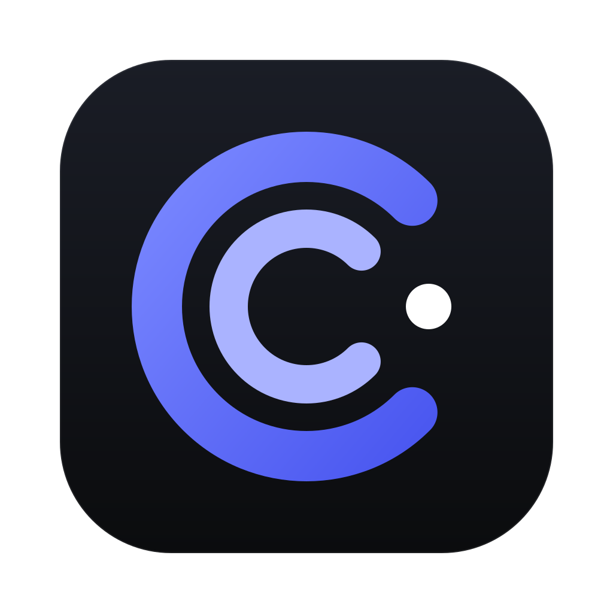
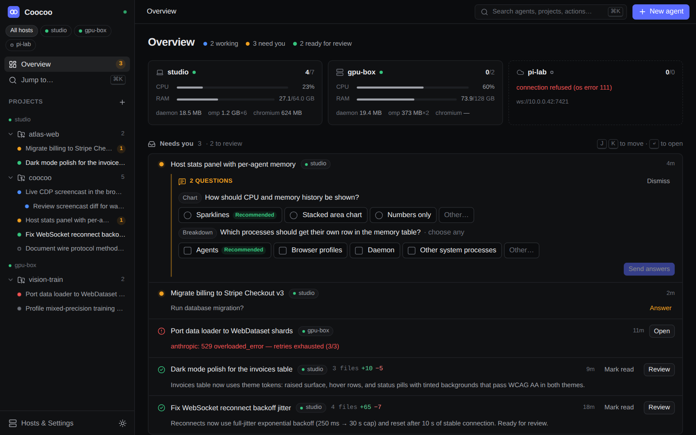
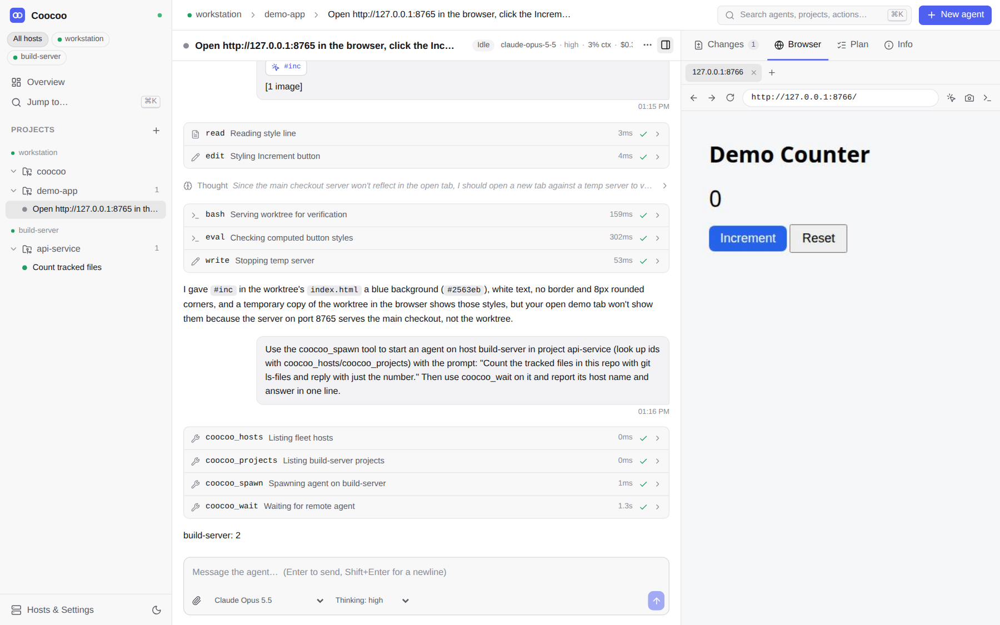
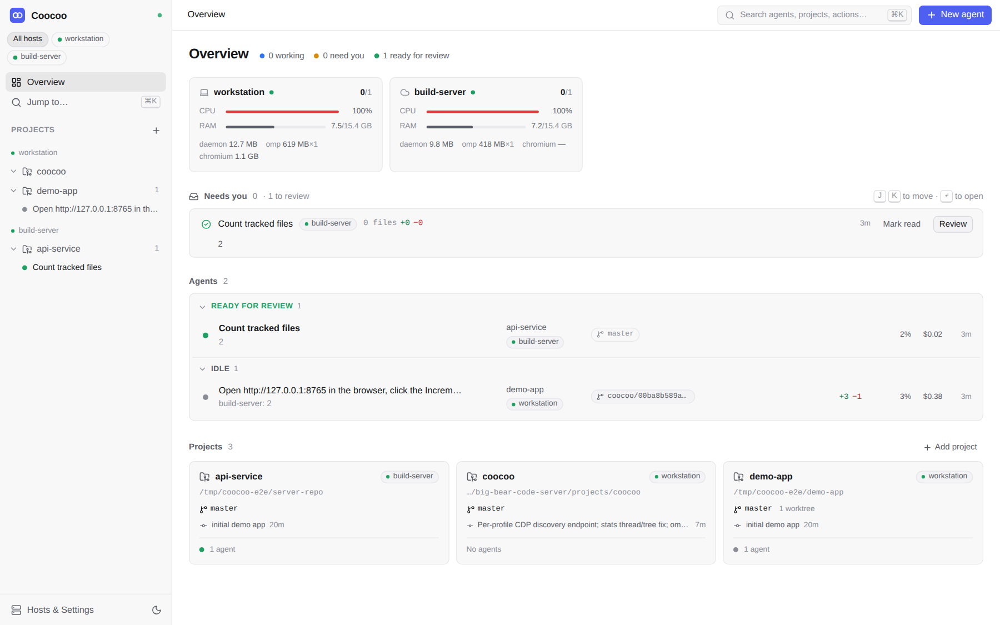
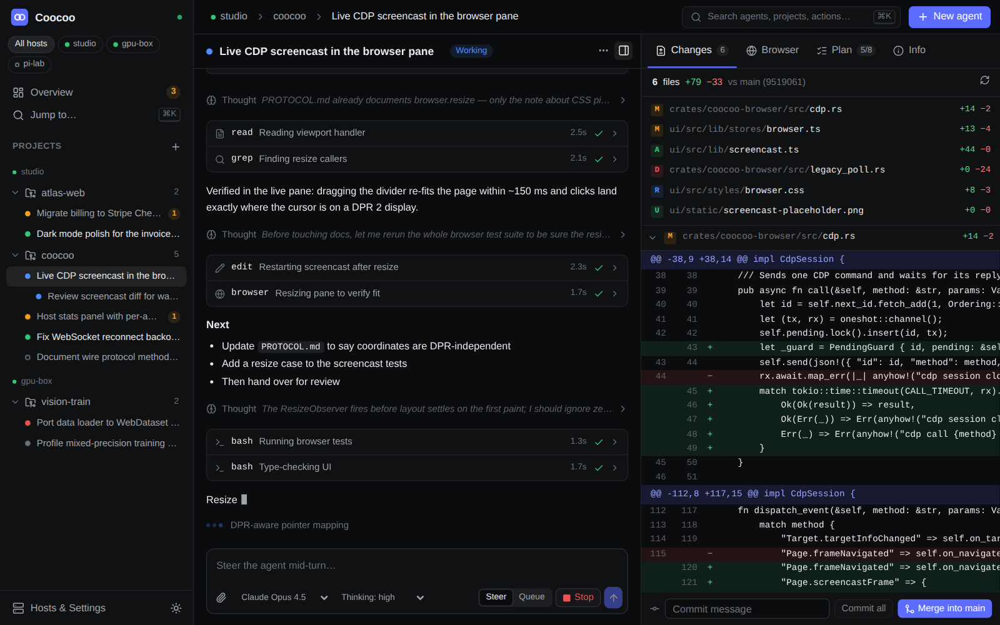
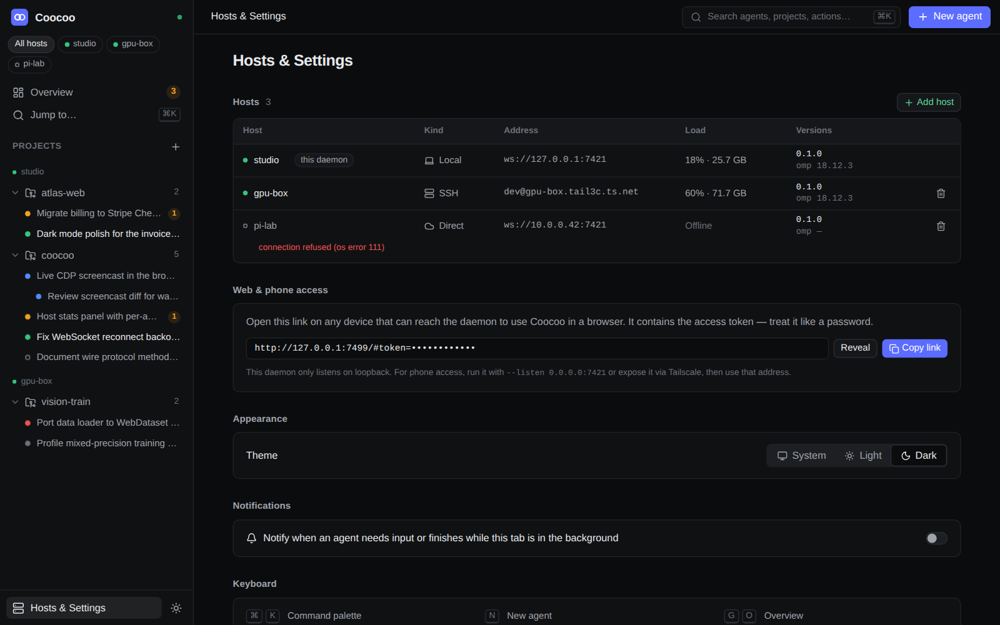
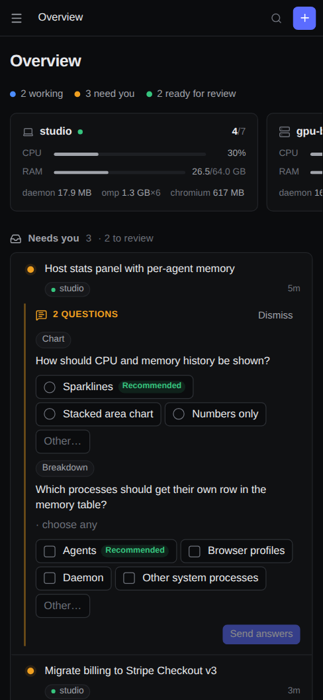

<p align="center"></p>

<h1 align="center">Coocoo</h1>

<p align="center">An agentic development environment that stays out of your RAM.<br>
Many <a href="https://github.com/can1357/oh-my-pi">omp</a> agents, many machines, one calm overview.<br>
<a href="https://coocoo.dev">coocoo.dev</a></p>

<p align="center"></p>

Coocoo runs coding agents in parallel, each in its own git worktree if you want, on your laptop
and on any number of servers. You watch and steer all of them from a single overview: who needs
you, who is working, what is ready for review, and what each machine is spending in CPU and memory.
It is in the same category as Paseo, Superset, Conductor and Orca, built around different priorities.

| Priority | How Coocoo does it |
|---|---|
| **Project overview** | One overview across every host: a needs-you queue (questions, approvals, errors, finished turns) with inline answers and j/k triage, agents grouped by state with diff stat, todo progress, context use and cost, live per-host CPU/RAM broken down into Coocoo, omp and Chromium, and a projects grid with git state. Every agent shows the git state of its directory (branch, ahead/behind its upstream or base branch, uncommitted files, conflicts, a merge or rebase in progress, other agents in the same checkout), and a bar above the composer flags a checkout behind its upstream before the next prompt, with fetch, fast-forward and “ask the agent to update”. From the same git chip you push the branch (a confirmation listing the outgoing commits in a shared checkout), open a GitHub pull request (a prefilled form, or let the agent write it), follow its checks and review, and merge it, through `gh`; nothing is polled, the status refreshes when you look. While the agent is answering, these actions wait (only fetch stays available), so nothing moves the branch under a running turn. |
| **Low resource use** | A Rust daemon (5.4 MB binary with the web UI embedded, ~7 MB RSS and no measurable CPU when idle) instead of Node and Electron. A Tauri 2 shell on the system webview. Nothing polls while nobody is watching, idle agents hibernate, Chromium starts on first use and stops when idle, and the UI's initial bundle is 91 KB gzipped. |
| **Multiple devices** | The same daemon runs on desktops and headless servers. A client connects to one daemon, which links to peers directly (LAN, Tailscale, WireGuard) or through an SSH tunnel it starts and supervises itself. It can install itself on the server over SSH. Requests are routed per host and events are relayed, so one window, or one phone browser, shows the whole fleet. |
| **omp only** | No lowest common denominator across harnesses. Coocoo uses omp's RPC protocol directly through the official Rust client: structured `ask` dialogs, todos, subagent counts, `session_settled`-accurate status, session resume, and orchestration host tools (spawn, message and wait for agents on any host) injected without MCP. The agent writes a one- or two-sentence summary of its current task, which stays pinned above the chat with the plan's progress and a jump back to the request. The composer shows the model provider's subscription quota the way that provider meters it (5-hour and weekly windows, extra usage, several accounts), read from `omp usage`. |
| **Browser use** | Each project gets a Chromium owned by the daemon on the host where the code runs. omp's own browser tool attaches to it, and every client watches the same tab through a screencast and can take over with mouse and keyboard. That includes a phone, and a headless server. Design mode turns a clicked element into prompt context (screenshot, selector, computed styles, HTML). Every screenshot an agent takes and every image it looks at opens in the side panel's *Images* tab as it comes in (unless you are typing in that panel), next to the design mocks of its refinements, its card's images and the images you sent it. |
| **Kanban per project** | Queue work on a project's board and hand a card to one of its agents or to a new one (optionally in its own worktree); the agent's top card sits above its composer for one-tap starts. Or ask for a refinement first: the agent researches what it can, asks you the rest in the chat and attaches a plan with UI mocks (images, HTML) to the card, which the agent implementing it then follows. Cards show the agent working on them, and the agent finishes them itself (`kanban_done`), which commits the change when the project uses git and, if the board says so, pushes it and opens a pull request. Importers fill an inbox column you pick from, on a schedule (every 15 min, hourly, every 6 h, daily): RSS/Atom feeds, any command (`gh issue list …`), or small scripts an agent writes for you (“put every new release from X's changelog in the inbox”), which run sandboxed with Landlock on Linux and which the agent can change or delete later. |
| **Scheduled runs** | A project can run agents on a schedule: daily, on weekdays, weekly, monthly, hourly, any cron expression in the time zone you pick, or once at a set time. Each run starts a fresh agent with the schedule's prompt (optionally in its own worktree and with its own model) or sends the prompt to one of the project's agents; a busy agent is skipped, never queued. Runs happen on the project's host while its daemon runs, and one missed while it was down happens once when it is back. Agents can schedule runs themselves (“every morning review yesterday's commits”, “continue this tomorrow at 9”). |
| **Secrets for agents** | An agent that needs an API key asks for it with `coocoo_secret_request`; you type it into a dialog in the chat (or the needs-you queue), and it goes to the daemon, never to the agent. Coocoo keeps it per project (file mode 0600) and gives it to every agent of the project as `$NAME`, optionally also as a line in `.env` or a whole file in the agent's directory, which it keeps out of git. omp's secret obfuscation shows the model a placeholder wherever the value appears, commands still run with the real value, and Coocoo strips it from transcripts. The project view lists, replaces and deletes secrets and adds new ones; values are never shown. This guards against accidental leaks, not a determined agent: it runs as your user, and a deliberately re-encoded value (base64, hex) or one under 8 characters reaches the model unmasked. |
| **Stats & workflows** | Two tabs next to the overview. *Stats* shows what the Coocoo agents on every host used — API-equivalent cost, tokens, requests, models (cache hits, time to first token, speed), days, projects, agents (incl. deleted ones, cost split into main agent, subagents and advisor), commits attributed to agents, tools, a weekday × hour heatmap, Kanban throughput and omp's frustration signals —, with every number's formula and source one click away. *Workflows* shows how work flows: agent journey and Kanban funnels, session shapes, frequent sequences, feature use and friction (re-asked questions, long needs-you waits, aborts, crashes…), each with links to the agents behind it; *Analyze patterns* hands this to an agent that files evidence-backed improvement ideas into a board's inbox. |
| **Clean UI** | Svelte 5, hand-written design tokens, dense and quiet, in dark and light, responsive down to phone width, with a ⌘K palette and keyboard navigation. A terminal in the agent's or project's directory on its host (the shell keeps running when you close the panel) is one tab away: links in it open on click (`localhost` ones in the agent's browser panel), Copy/Paste work on every device, and on a touch screen it adds the keys phone keyboards lack (Esc, Tab, sticky Ctrl/Alt, arrows, Home/End, PgUp/PgDn, `\|`, `~`), a keyboard toggle and pinch-to-zoom for the font. |

## Screenshots

Real session: a workstation agent drove the project's Chromium (live view on the right, taken
over by hand mid-run), restyled an element picked in design mode, then spawned and awaited an
agent on another host through the `coocoo_*` tools.



| Fleet overview (real, two hosts) | Agent, changes |
|---|---|
|  |  |
| **Hosts & settings** | **Phone** |
|  |  |

## Quick start

You need [omp](https://github.com/can1357/oh-my-pi) installed and logged in on every machine that
runs agents, plus `git`. A Chromium-family browser is needed for browser features. Coocoo finds
Chrome, Chromium, Edge or Brave on `PATH`, or Playwright's cache, or `COOCOO_CHROME`.

**Desktop:** download the installer from the
[latest release](https://github.com/BlackMac/coocoo/releases/latest) (also linked from the
download icon next to the logo in the web UI) or build the Tauri app yourself (see
[Development](#development)). It starts the daemon in-process. If a `coocoo serve` is already
running with the same config, it attaches to that one instead. Closing the window hides it to the
tray and the agents keep running.

**Server (headless):** install the `coocoo` binary (Linux x86_64/aarch64, macOS; no Rust needed)
to `~/.local/bin` from the latest release, then start it:

```sh
curl -fsSL https://coocoo.dev/install.sh | sh   # `| COOCOO_VERSION=v0.5.0 sh` pins a release
coocoo serve                      # listens on 127.0.0.1:7421 by default
coocoo serve --listen 0.0.0.0:7421  # LAN / Tailscale access
coocoo pair                       # prints a web-UI link with token + QR code for your phone
coocoo status | token | version
```

**Add a server to your desktop:** open *Hosts & Settings → Add host*.
- **Link** (default): paste the server's connect link (`http://host:7421/#token=…`) from
  `coocoo pair` on it or from *Hosts & Settings* in its UI; Coocoo connects directly to it.
- **SSH:** enter `user@server`. Coocoo opens `ssh -N -L …` with your existing keys, fetches the
  token with `coocoo token`, and keeps the tunnel alive. Tick *install* to put the binary in
  `~/.local/bin/coocoo` (a copy of the local one when OS and architecture match, otherwise the
  server downloads the release build of the same version) and start it as a systemd user service
  (or with `nohup` when systemd isn't available).
- **Direct URL:** the server's WebSocket URL and token (pasting a connect link fills both).

**Phone:** open the pairing link from `coocoo pair` (on your LAN or tailnet). It serves the same
UI as the desktop app.

## How it works

- [docs/ARCHITECTURE.md](docs/ARCHITECTURE.md): daemon, peer links, omp integration, resource rules.
- [docs/PROTOCOL.md](docs/PROTOCOL.md): the WebSocket protocol (every method and event).

```
crates/coocoo-proto      wire types, event bus, Orchestrator trait (the contract)
crates/coocoo-core       daemon: config, HTTP/WS server, routing, peers (direct + SSH), embedded UI
crates/coocoo-agents     omp supervisor: RPC processes, timelines, hibernation, host tools
crates/coocoo-browser    Chromium per project over raw CDP: discovery, screencast, input, design mode
crates/coocoo-workspace  projects, git (status/diff/worktrees/commit/merge/push), GitHub PRs via gh, fs, host stats, terminals
crates/coocoo-cli        the `coocoo` binary
crates/omp-rpc           official omp RPC client (vendored, MIT)
src-tauri                Tauri 2 desktop shell (tray, notifications, embedded daemon)
ui                       Svelte 5 web UI (desktop, web, phone)
website                  coocoo.dev homepage (PHP for Hetzner Webhosting, see website/README.md)
```

## Resource use

Measured on Linux x86_64 (Ubuntu 24.04, release builds, 2026-10-22). Memory is PSS (shared pages
split between processes) unless noted; summing RSS over multi-process trees overstates Chromium
about 3×.

| | |
|---|---|
| `coocoo` binary, web UI included | 5.4 MB |
| `coocoo-desktop` binary | 11.6 MB |
| Daemon, idle, peered, with a project and a hibernated agent | 7.6 MB RSS / 3.2 MB PSS, 6 threads, 0 CPU ticks in 30 s |
| Daemon while streaming stats to a client | ~9–13 MB RSS |
| Desktop app, idle on the overview (Xvfb, software rendering) | 248 MB total: shell + embedded daemon 90 MB, WebKit network process 20 MB, WebKit web process 138 MB |
| UI initial JS / CSS (gzip) | 91 KB / 12 KB; diff and browser panels lazy-loaded (+5 KB / +6 KB) |
| One omp agent (busy) | 150–210 MB |
| One project Chromium with one tab (headless) | ~350 MB (1.1 GB if you sum RSS) |

Most of the memory goes to the agents themselves and Chromium, and Coocoo keeps both short-lived:
idle agents hibernate after 15 minutes (configurable) and resume their omp session on the next
prompt, and a project's Chromium stops 10 minutes after its last watcher or CDP client leaves.
The host cards in the overview show this breakdown live.

## Configuration

`~/.config/coocoo/config.toml` is created on first run. `COOCOO_HOME` or `--home` moves
everything, so several daemons can share one machine.

```toml
name = "workstation"
listen = "127.0.0.1:7421"

[agents]
hibernateAfterSecs = 900      # 0 = never
restartGraceSecs = 60        # on a restart, how long running agents get to pause
defaultModel = "anthropic/claude-opus-5-5"
extraArgs = []

[browser]
headless = true
idleShutdownSecs = 600
maxFps = 12
quality = 70

[insights]
enabled = true                # the usage log behind the Workflows tab (local only)
retentionDays = 365           # 0 = keep forever
```

**Usage log.** Each host records what happens in Coocoo — actions such as creating, prompting or
aborting an agent, card moves, commits, and which views, panels, dialogs and commands you use and
on which kind of device — in `<data dir>/events/` (`~/.local/share/coocoo/events/` on Linux). It
never stores prompt texts, arguments, file contents or paths, stays on the host and only travels
over your own fleet links (and to the model provider of an *Analyze patterns* agent, which reads
the aggregated numbers). Switch it off or delete it under *Hosts & Settings → Usage log*. The
Stats tab itself reads omp's own `~/.omp/stats.db` (read-only); its frustration drill-down shows
prompt texts from there.

## Project actions

A project can put buttons into Coocoo with `.coocoo/actions.toml` in its directory (this repository
has one). They show up under **▶ Run** in the project header (scope `project`/`both`) and in the
header of each of its agents (`agent`/`both`), and as “Run: …” in ⌘K. The file is read from the
main checkout, also for agents in worktrees, and reloaded on every change; problems are listed in
the Run menu with their line. Agents can check it with the `coocoo_actions` tool.

```toml
[[action]]                # order = order in the menu
name    = "Dev server"    # required; id defaults to its slug ("dev-server")
icon    = "server"        # play, server, test-tube, terminal, rocket, globe, bug, package,
                          # database, wrench, refresh, message, external-link
scope   = "agent"         # project | agent | both (default)
default = true            # the Run button's one-click action (else the first)
run     = "npm run dev -- --port 5173"
cwd     = "ui"            # relative to the project or the agent's worktree

[[action]]
name   = "Review diff"
scope  = "agent"
prompt = "Review the changes on {branch}."   # also {project}, {cwd}

[[action]]
name     = "Release notes"
scope    = "project"
prompt   = "Write release notes since the last tag."
worktree = true           # project view: a new agent in its own worktree

[[action]]
name    = "Deploy"
scope   = "project"
run     = "./scripts/deploy.sh"
confirm = "Deploy main to production?"

[[action]]
name   = "Preview"
url    = "http://localhost:5173"   # loopback → the project's browser panel, else the system
target = "browser"                 # browser; `target` overrides (browser | external)
```

- **`run`** starts `$SHELL -lc '<command>'` in its own terminal on the project's host: in the
  project directory, or in the agent's directory (its worktree). It gets `COOCOO_PROJECT_DIR`,
  `COOCOO_WORKDIR` and `COOCOO_ACTION`. Starting it again restarts it (one run per action and
  directory; different worktrees run side by side, so pick ports per worktree yourself). A
  finished run stays in the terminal tab with its exit code and output until restarted or closed.
  Stop hangs up the process group: keep servers in the foreground (no daemon modes).
- **`prompt`** goes to the agent (queued after the current turn if it is working); in the project
  view it starts a new agent with that prompt.
- **`url`** opens in the project's browser panel (agent view, loopback hosts) or the system browser.

## Development

```sh
# UI
cd ui && npm install && npm run build      # → ui/dist (embedded by the daemon, bundled by Tauri)

# daemon / CLI
cargo build --release -p coocoo-cli        # → target/release/coocoo
cargo test --workspace

# desktop (Linux needs webkit2gtk-4.1 + gtk3 dev packages)
cd src-tauri && npm install && npm run build   # deb / AppImage / dmg / nsis bundles
```

Releases: pushing a `v*` tag (or running *Desktop release* manually) makes
`.github/workflows/desktop-release.yml` build the Linux, macOS (universal, ad-hoc signed) and Windows
installers plus the `coocoo` CLI archives (`coocoo-linux-x86_64.tar.gz`, `coocoo-linux-aarch64.tar.gz`,
static musl; `coocoo-macos-universal.tar.gz`) that `install.sh` downloads, and publish them as a
GitHub release. Running it manually with *cli_tag* (e.g. `v0.4.0`) only adds the CLI archives to that
existing release. The ad-hoc signature avoids macOS calling the app
"damaged" on Apple Silicon; it is not notarized, so macOS blocks the first launch: open it once, then
allow it under System Settings → Privacy & Security → "Open Anyway" (again after every update, since
each build has a new signature).

## Status and known limitations

- Verified end to end on Linux: daemon, web UI, real omp agents, the browser live view with
  human takeover, design mode, two-host fleet with cross-host orchestration, and the desktop app
  under Xvfb. macOS and Windows builds exist only through the release workflow and have not been
  tested by hand.
- SSH peers (tunnel, token fetch, install over SSH) have been run against a real `sshd` only in a
  local Alpine container (install by download, wget, static Linux build), not yet a remote machine.
- Direct peer links are plain `ws://` with a bearer token. Use them on a LAN or VPN (Tailscale,
  WireGuard), or use SSH peers. Each daemon has a single shared token; there are no per-device
  tokens and no way to revoke one device.
  A secret you enter for an agent on another host travels the same way.
- Agent secrets rely on omp behaviour that is not a documented contract (omp 18.12): which env var
  names it masks, the 8-character minimum and that it loads secrets only when a session starts
  (hence Coocoo's restart after a new secret). An omp update can change that.
- Installing over SSH downloads the release build on the server when it can't copy the local
  binary (other OS/architecture, or the desktop app, which ships no `coocoo` CLI). That needs `curl`
  or `wget` there and a release with CLI archives for the local version.
- An agent working in a worktree can't see its changes on a dev server that runs from the main
  checkout. It has to start its own server for the worktree.
- `crates/omp-rpc` tracks omp v18.12.3. Frames it doesn't know decode to `Unknown` and are ignored.

## License

MIT. `crates/omp-rpc` is vendored from oh-my-pi (MIT); see `crates/omp-rpc/VENDORED.md`.
